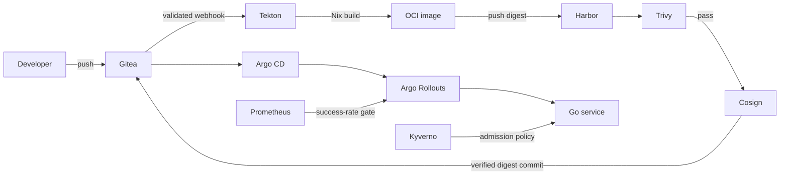
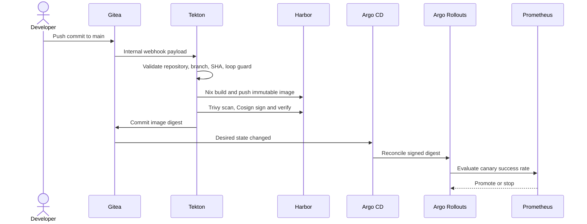

# Pantanal CI/CD control plane

[](https://github.com/cchostak/pantanal/actions/workflows/ci.yml)
[](https://github.com/cchostak/pantanal/actions/workflows/security.yml)
[](LICENSE)

Pantanal is a reproducible local reference platform for secure software
delivery. It turns a Git push into a scanned, signed, immutable OCI artifact
and promotes that digest through GitOps with policy and metric gates. It is
designed for platform engineers evaluating delivery architecture—not as an
internet-facing production installation.

## Architecture





Build automation has no deployment permission. Argo CD receives read-only Git
credentials and no registry push or signing authority. Workloads are non-root,
tokenless, read-only, and protected by Pod Security, NetworkPolicy, and Kyverno.
See [the architecture contract](docs/architecture.md) and
[ADR 0002](docs/adr/0002-core-architecture-and-stack.md).

## Quickstart (under five minutes, excluding image downloads)

### Prerequisites

- Linux or macOS with at least 8 CPU, 12 GiB RAM, and 30 GiB free disk
- [Nix](https://nixos.org/download/) with flakes enabled
- Docker Engine or Docker Desktop running
- Git and outbound HTTPS access

### Installation

```bash
git clone https://github.com/cchostak/pantanal.git
cd pantanal
make doctor
make bootstrap
```

Bootstrap is idempotent. Generated credentials are stored with mode `0600`
under the ignored `platform-infra/secrets/` directory and are never printed.

### Verification

```bash
make verify
make test-integration
```

| Service | Local URL |
| --- | --- |
| Gitea | <http://gitea.localhost:30000> |
| Harbor | <http://harbor.localhost:30003> |
| Argo CD | <http://argocd.localhost:30080> |

Run `make teardown` to delete the cluster. Local state is intentionally
ephemeral; secret files remain so repeated bootstraps preserve identities.

## Developer workflow

```bash
nix develop ./platform-infra
pre-commit install --install-hooks --hook-type pre-commit --hook-type commit-msg
make fmt
make check
make test
make scan
make test-smoke
```

`make test-smoke` owns and removes a cluster it creates. It preserves a cluster
that was already present and collects failure diagnostics in
`.pantanal-smoke-state/`.

## Application endpoints

| Path | Purpose | Success response |
| --- | --- | --- |
| `/` | Versioned service payload | JSON, HTTP 200 |
| `/healthz` | Process liveness | `ok`, HTTP 200 |
| `/readyz` | Traffic readiness | `ready`, HTTP 200; otherwise 503 |
| `/metrics` | Prometheus counters | OpenMetrics text, HTTP 200 |

Only `GET` is accepted. Other methods return HTTP 405 and an `Allow` header.

## Configuration reference

### User configuration

| Variable | Default | Meaning |
| --- | --- | --- |
| `LISTEN_ADDRESS` | `:8080` | Go server bind address in `host:port` form. |
| `READ_HEADER_TIMEOUT` | `5s` | Maximum duration for request headers. |
| `READ_TIMEOUT` | `15s` | Maximum duration for reading a request. |
| `WRITE_TIMEOUT` | `30s` | Maximum duration for writing a response. |
| `IDLE_TIMEOUT` | `60s` | Keep-alive idle timeout. |
| `SHUTDOWN_TIMEOUT` | `10s` | Graceful shutdown deadline. |
| `LOG_LEVEL` | `info` | `debug`, `info`, `warn`, or `error`. |
| `PANTANAL_HTTP_RETRIES` | `60` | HTTP readiness polling attempts. |
| `PANTANAL_HTTP_RETRY_SECONDS` | `5` | Delay between readiness attempts. |
| `PANTANAL_KEEP_SMOKE_CLUSTER` | `0` | Set to `1` to retain a smoke-created cluster. |

Copy `.env.example` to `.env` for local overrides. `.env` accepts only
`UPPER_CASE=value` lines and must not contain secrets.

### Pinned platform settings

`platform-infra/versions.env` owns `KIND_NODE_IMAGE`,
`TEKTON_PIPELINES_VERSION`, `TEKTON_TRIGGERS_VERSION`,
`TEKTON_INTERCEPTORS_VERSION`, `KYVERNO_CHART_VERSION`, and `TRIVY_VERSION`.
Generated `GITEA_*`, `HARBOR_*`, and `COSIGN_PASSWORD` values are internal
bootstrap secrets, not user configuration.

## Troubleshooting

| Symptom | Diagnostic | Resolution |
| --- | --- | --- |
| `nix: command not found` | `make doctor` | Install Nix and enable `nix-command flakes`. |
| Docker is unreachable | `docker info` | Start Docker and verify socket permissions. |
| A local port is occupied | `ss -ltn` | Free ports 30000, 30003, 30022, and 30080. |
| Pods never become ready | `kubectl get pods -A` | Inspect `kubectl describe pod` and namespace events. |
| No PipelineRun appears | Inspect Gitea hook delivery and `kubectl logs -n ci -l eventlistener=sample-app` | Confirm the push is to `main` and is not a `chore(deploy):` commit. |
| Build or scan fails | `kubectl get pipelineruns -n ci` | Inspect failed TaskRun logs and the Trivy result. |
| Image pull fails | Check Harbor project and `harbor-pull` secret | Re-run `make bootstrap` to reconcile scoped credentials. |
| Argo cannot sync | `kubectl get application -n argocd -o yaml` | Check repository credentials and AppProject restrictions. |
| Rollout pauses or aborts | `kubectl argo rollouts get rollout sample-app -n sample-app` | Inspect Prometheus query data and AnalysisRuns. |
| Signature verification fails | Inspect `cosign-verify` TaskRun | Reconcile the signing secret; do not bypass promotion. |
| Smoke test fails | Read `.pantanal-smoke-state/` | Re-run with `PANTANAL_KEEP_SMOKE_CLUSTER=1` for inspection. |

## Governance

- Contributions: [CONTRIBUTING.md](CONTRIBUTING.md)
- Vulnerability reporting: [SECURITY.md](SECURITY.md)
- Architecture decisions: [docs/adr/](docs/adr/)
- Service catalog metadata: [catalog-info.yaml](catalog-info.yaml)
- License: [Apache-2.0](LICENSE)
